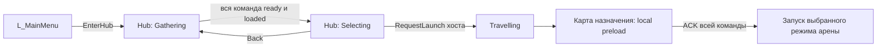

# Архитектура MessControl

Актуализировано **23.10.2026** по текущему C++, `.uproject`, конфигурации и исходникам инструментов. Полный файловый каталог — [SourceCatalog.md](SourceCatalog.md), выводы аудита — [ProjectAudit.md](ProjectAudit.md), ресурсы и авторинг — [ContentAndTools.md](ContentAndTools.md).

В этом срезе 578 файлов `Source` / 123291 строка, 3538 `.uasset` и 21 `.umap`. Подсчёт отражает состав, а не готовность каждой механики. Saved asset snapshot от 21.10 устарел: `build_current=false`, все 1343 подробных снимка имеют `schema_changed`. Значения сохранённых Blueprint/CDO/DataTable не подменяются нативными defaults. Runtime, builds, tests, PIE и cook в документационном аудите не запускались.

## Движок, targets и модули

Association проекта — **5.8**; локальный `E:/UE/UE_5.8/Engine/Build/Build.version` содержит **5.8.1, CL 56057345**. Оба target используют `BuildSettingsVersion.V7` и include order `Unreal5_8`.

| Слой | Состав и граница |
| --- | --- |
| `MessControl` Game target | Runtime-модуль `MessControl`, игровая логика, UMG, Chaos/Physics Control, Niagara, online/voice, MoviePlayer, sequence и procedural mesh |
| `MessControlEditor` Editor target | `MessControl` + `MessControlEditor`: редакторские представления, коллизия/authoring, Blueprint/graph/menu интеграции |
| `MessControlProjectIndex` plugin | Editor-only commandlet для чтения сохранённых пакетов; не сохраняет source assets и исключён из game target |
| `KawaiiPhysics` plugin | Runtime, Runtime Sequencer и UncookedOnly editor-модули; optional upstream test module не включён |
| `StylizedDynamics` | Optional локальный provider; `Build.cs` проверяет наличие source и определяет `WITH_MC_STYLIZED_DYNAMICS`. В версионируемый набор не включён |

Фактические зависимости перечислены в `MessControl.Build.cs`, `MessControlEditor.Build.cs` и `.uplugin`; каталог [SourceCatalog.md](SourceCatalog.md) даёт навигацию по ним. Engine plugins Python/EditorScripting/SequencerScripting/MCP разрешены для Editor; их наличие не означает Python runtime в packaged игре или подключённый live MCP.

## Владение состоянием

Проект использует стандартный `UGameInstance`: `GameInstanceClass=/Script/Engine.GameInstance`. Долгоживущие службы выделены в subsystems; игровые сущности и реплицируемые состояния принадлежат текущему World.

| Владелец | Ответственность |
| --- | --- |
| `AMCGameMode` | Серверные правила арены, выбор ветки director, старт/рестарт, участники, objectives, смерть/respawn |
| `AMCGameState` | Репликация run settings snapshot, фаз/времени/здоровья рта, objectives, director state/history, single-day director, командных tool upgrades и живых больших зубов |
| `AMCHubGameMode` | Серверные membership/readiness, phase generation, host requests, безопасный выбор назначения и travel |
| `AMCHubGameState` | Реплицируемые `Gathering/Selecting/Travelling`, выбранный день, loaded/ready roster и notice; определения направлений из DataTable |
| `AMCPlayerState` | Персональный score, perks/reward choices, hub economy, fish и переносимое состояние участника; `CopyProperties` для замены PlayerState |
| `AMCToothCharacter` | Pawn, действия, удерживаемые цели, физическое/визуальное состояние героя и компоненты |
| `AMCPlayerController` | Локальный UI/input/focus/camera context; принадлежащие игроку RPC, ready acknowledgements, hub interactions и scene audio |
| Main menu GameMode/Controller | Изолированное меню, intro, UI, локальная подготовка сцены и вызовы session subsystem |
| Data Assets / DataTables | Авторские правила и ссылки; не замена серверному mutable runtime state |

Десять project subsystems имеют отдельную область жизни:

| Subsystem | Scope | Назначение |
| --- | --- | --- |
| `UMCSteamSessionSubsystem` | GameInstance | Session operations, поиск/инвайты, вход в Hub, подключения и возврат в меню |
| `UMCVoiceChatSubsystem` | GameInstance | OSS voice, talkers, PTT/open mic, mute, input level, offline mic test; переживает travel |
| `UMCHubProfileSubsystem` | GameInstance | Серверное чтение/запись персональных hub profiles, cache и защита повреждённых saves |
| `UMCTravelLoadingSubsystem` | GameInstance | Asset-free Slate/MoviePlayer экран при блокирующем map load; сам по себе не доказывает visual readiness |
| `UMCStudioSplashSubsystem` | GameInstance | Помечает startup ident показанным в этой сессии; возврат из Hub/game не запускает его заново |
| `UMCWorldPreloadSubsystem` | Tickable World | Локальный loading/rendering/streaming barrier конкретного game/PIE World |
| `UMCGroundImpactSubsystem` | Tickable World | Серверные приземления тяжёлых props и связь с реакциями ткани, независимо от попадания по игроку |
| `UMCAnimationComparisonSubsystem` | World | Локальное сравнение Native/Kawaii/optional StylizedDynamics, samples; не меняет authoritative movement/damage |
| `UMCValidationSubsystem` | Tickable World | Development harness и capture/smoke fixtures, отключённые в Shipping |
| `UMCFrontEndValidationSubsystem` | Tickable World | Отдельный opt-in harness меню/обучения, не обычный gameplay service |

## Вход, Hub и выбор назначения

Конфигурация разделяет `EditorStartupMap=/Game/Maps/L_Mouth` и `GameDefaultMap=/Game/Maps/L_MainMenu`; global default GameMode — `/Game/Blueprints/BP_MouthGameMode.BP_MouthGameMode_C`. World Settings и travel options могут назначать другой GameMode.

`EnterHub` через Steam создаёт комнату; fallback открывает `Hub?listen?game=/Script/MessControl.MCHubGameMode`. Сервер считает физических участников и ready volumes. Подтверждение загрузки связано с `SceneGeneration`: устаревшее подтверждение не относится к новой презентации.

`RequestOpenSelection` проверяет хоста, Gathering, `AreAllReady()` и `AreAllLoaded()`, после чего меняет фазу на **Selecting в том же Hub**. Контроллер/представитель выбора блокирует движение и восстанавливает его при закрытии. Обычный маршрут не путешествует в `L_HubSelection`; отдельный вход/совместимость этой карты сохраняется.

`FMCHubDestinationRow` задаёт день 1–7, локализованные title/description, `bEnabled`, soft `Map` и `SingleDayProfile`. Таблица: `/Game/Gameplay/Hub/DT_HubDestinations`. Нативные fallback-строки включают только день 1 → `L_Mouth`; дни 2–7 выключены. Узкое live-чтение clean таблицы подтвердило Day01/L_Mouth/DA_SingleDay и выключенные Day02–07 без map/profile. Дубликат дня отключается с диагностикой. Fresh disk exporter всего каталога не выполнялся.

`RequestSelectDay` изменяет выбранный день по запросу хоста. `RequestLaunch` читает `State->SelectedDay`, проверяет host/phase/all loaded, разрешение строки и существование `/Game`-карты. URL составляет сервер: `?MCLobby=1?MCHubRun=1?MCHubDay=N`; для `L_Mouth` добавляет BP GameMode override. Произвольный travel URL от клиента не является контрактом API. Подробности — [HubLobby.md](HubLobby.md).

## Режим забега и directors

Нативные defaults `AMCGameMode`: `bUseSingleDayLoop=false`, `bUseDayOnePlan=true`, `bUseAdaptiveDirector=true`. Прочитанный live clean CDO `BP_MouthGameMode` имел SingleDay=true и DA_SingleDay; это editor-loaded state, а не проверка нынешнего несобранного C++. В `BeginPlay` hub-origin run разрешает направление и включает single-day при enabled строке с совпадающей картой и непустым `SingleDayProfile`. `-MCSingleDay` включает его явно. `-MCLegacyDays`, `-MCCore`, `-MCDayOne` отключают single-day; legacy дополнительно отключает DayOne/adaptive, Core/DayOne — adaptive. Источники и ограничения live-чтения — в [ProjectAudit](ProjectAudit.md).

| Уровень | Роль |
| --- | --- |
| `AMCSingleDayDirector` + `UMCSingleDayProfile` | Авторенная последовательность этапов/встреч; после последнего слота bAuthoredFragmentComplete и бессрочная поддержка. Победа через zombie boss — только отдельный legacy finale |
| `AMCGameDirector` + `UMCGameDirectorProfile` | Адаптивное планирование и давление, telemetry/decision log, pacing в разрешённой ветке |
| `AMCDayDirector` + `UMCDayPlan` | Ранний авторский DayOne flow; не тождествен single-day sequence |
| `AMCTutorialDirector` | Отдельное обучение на `L_Tutorial` / `MCTutorial` |
| Legacy EventPool | Старый случайный цикл Coffee/Food/LooseTooth, сохранённый для совместимости и diagnostics |
| `AMCRoguelikeDirector` | Контекст roguelike-встреч/предложений в связке с run/event state |

`RestartShift` переносит проверенные run rules в реплицируемый `RunSettings`; клиентский HUD читает серверную копию. Таймеры используют серверные timestamps, а не независимые клиентские countdown. `?Seed=` и отдельные playtest seeds позволяют воспроизводить выбор. В dev sandbox deadlines/transitions могут подавляться, тогда как физика/урон продолжают работать.

Read-only live-чтение clean `DA_RunRules` показало HP=100, Days=7, MaxPlayers=4 и **InitialArenaTeeth=12**; нативное исходное значение числа зубов — 8. Это различие авторских данных и native default, а не пересчёт реальных socket actors карты.

Clean `DA_SingleDay` в загруженном редакторе содержит Nuts → Jellies → Ice → Fog, `DirectorSupportSeconds=120`, `OpeningMealPortions=[3,5,8]`, `AfterNutMealPortions=[5,8,9]`, `bLegacyTimedFinale=false`. Это узкие наблюдения loaded assets при выключенном PIE на `L_MainMenu`, не сертификация несобранного текущего source или полного игрового прохождения; общий saved exporter остаётся устаревшим.

Семь слотов выбора, `TotalDays` и legacy цикл не являются доказательством семи завершённых кампаний. Детали реализованных последовательностей — [SingleDay.md](SingleDay.md), [Day01.md](Day01.md), [Day00.md](Day00.md); целевое расширение — [GDD.md](GDD.md).

## Персонаж, движение и анимация

`AMCToothCharacter` — `ACharacter` с заменёнными movement/mesh default subobjects. Он создаёт runtime Enhanced Input mapping; мышь и правый стик вращают orbit-камеру. `UMCOrbitSpringArmComponent` и `UMCPlayerCameraComponent` отвечают за камеру, а не за серверное положение персонажа.

| Компонент | Область |
| --- | --- |
| `UMCToothMovementComponent` | CharacterMovement prediction, sprint/dash, stamina, отдельная swim energy, current/wind/root motion, surface response и selection movement lock |
| `UMCToothMeshComponent` / anim instance / secondary solver | Обновление визуального skeletal pose, процедурные движения/контакты и сравниваемая secondary animation |
| `UMCToothPhysicsComponent` + `UPhysicsControlComponent` | Standing/ragdoll/recovery, попадания, физическое следование и серверная передача состояния/позы |
| `UMCToothStatusComponent` | HP, загрязнение, лечение/уход и связанные дискретные результаты |
| `UMCInventoryComponent` | Выбранный инструмент, допустимость/поза/контакты, upgrades, cooldown и взаимодействие с типами целей |
| `UMCBrushContactComponent`, `UMCGripComponent` | Контакт щетины и процедурный хват/опорные точки |
| `UMCFoodCollectionComponent`, `UMCFishingRodComponent` | Переноска/stack еды и рыболовное состояние |
| `UMCGazeComponent`, `UMCExpressionComponent` | Взгляд, facial/morph expressions, эмоции и локальное представление |
| `UMCCombatFeedbackComponent` | Реакции/подсказки попаданий и результата действия |
| `UMCCharacterCosmeticsComponent` | Отображение аксессуаров/персональной внешности |
| Name, audio и tool scene components | Подписи игроков, звуковая обратная связь и видимые инструменты |

Movement snapshots привязаны к подтверждённому movement timestamp. Stamina и swim energy учитываются отдельно и восстанавливаются при prediction replay/correction. Нажатие sprint сразу запрашивает dash, удержание — sprint; отмена ввода снимает pending intent. Лёд ног ограничивает locomotion, сохраняя допустимые инструментальные действия.

Плавание, ragdoll, посадка/гребля на плоту, захват горлом/mimic, perk UI и смерть задают дополнительные запреты/режимы. Анимация не является самостоятельным источником игровых HP, collision или движения. KawaiiPhysics добавляет secondary motion выбранным костям; Physics Control решает другую задачу физического следования. См. [Locomotion.md](Locomotion.md), [Physics.md](Physics.md), [AnimationComparison.md](AnimationComparison.md).

## Уход, зубы арены и возрождение

Инструментальные действия проходят через принадлежащего игроку pawn/controller. Сервер проверяет состояние, дистанцию, угол/видимость, тип инструмента и cooldown; клиент не задаёт произвольный итоговый прогресс. Контактная уборка, self-care, помощь союзнику, лечение и ледяные ограничения имеют отдельные ветки.

`AMCArenaTooth` — конкретный реплицируемый большой зуб с HP/загрязнением/состоянием; `AMCArenaToothSocket` задаёт авторское место/ID/mesh. `AMCGameState::ArenaTeeth` хранит ссылки. Наличие доступных зубов используется для respawn; отдельного независимого счётчика жизней, уменьшаемого параллельно списку, нет. Сохранённое расположение карты этим source audit заново не измерялось.

При смерти GameMode ведёт очередь и ищет пригодный зуб/безопасное место появления. Персональные PlayerState-перки переживают смену pawn; pawn-side состояние и bindings пересоздаются. Успешный respawn расходует конкретный ресурс арены. Удар инструментом по союзнику в проверенных ветках вызывает `ToothPhysics->ApplyHit`, без прямого уменьшения HP именно там; hazards/enemies используют собственные damage paths.

Чистка изменяет локальные пятна/маски, загрязнение героя и налёт; calculus/tooth damage имеют свои компоненты/материалы. Удаление декоративного mesh не удаляет автоматически серверную задачу. Основные профили — `DA_ToothCare`, `DA_ArenaTooth`, `DA_Equipment`; [BrushCleaning.md](BrushCleaning.md), [CareAndHandling.md](CareAndHandling.md), [ToothDamage.md](ToothDamage.md).

## Еда, ткани, жидкости и события

`AMCFoodActor` владеет серверной физикой и food state; visual mesh, collision/body и presentation разделены. DataTable задаёт whole/fragment варианты, массу, тип, HP и сроки. При разрушении используются подготовленные `FragmentMeshes`, а не runtime slicing произвольных треугольников. Общая стоимость/масса и состояние фрагментов обрабатываются игровыми правилами.

Порча определяется абсолютным `SpoilAt` и реплицируемым `bSpoiled`; переноска сама по себе не обнуляет часы. Существуют modifiers сохранности. `MCFoodAbsorption.cpp` сохраняет совместимые поля/API, но поиск absorption floor возвращает false, прогресс 0, завершение пустое: обычная еда не растворяется в ткани и не создаёт язвы через старую absorption систему.

Хват, извлечение, stack, бросок/наведение, приём еды горлом и неправильный front discard — отдельные проверки. `AMCFoodDisposal`/`AMCThroat` и зоны доставки владеют соответствующим результатом. Показ HP, freshness и danger не заменяет серверное правило допустимой утилизации. См. [FoodRework.md](FoodRework.md), [FoodStackHolding.md](FoodStackHolding.md), [FoodCollisionAutomation.md](FoodCollisionAutomation.md).

`AMCTongue` объединяет видимую деформацию, опору/коллизию, давление, следы и реакции; профиль `DA_Tongue` и pressure presets задают параметры. `UMCGroundImpactSubsystem` передаёт удары тяжёлых props. Глотка, язвы, stuck food и утилизация используют отдельные actors/контакты; описание — [Tongue.md](Tongue.md), [TonguePressure.md](TonguePressure.md), [LivingThroat.md](LivingThroat.md).

Кофе/flood/puddles, cold cola, лёд и mint/Frost Nova, Fog Brawl, катаклизм с плотами/желе, vomiting и окружение создаются своими event actors. Directors выбирают и завершают события; GameState/HUD отражают ход. Состояния/случайные выборы на сервере, косметические материалы/particles — в клиентском представлении. Это набор отдельных игровых моделей, а не универсальный fluid solver. См. [CoffeeWater.md](CoffeeWater.md), [IceEvent.md](IceEvent.md), [FogBrawl.md](FogBrawl.md), [Cataclysm.md](Cataclysm.md).

## Противники, награды и экономика

Акторы/код Cataclysm Rafts сохранены, но `IsVariantEnabled(Rafts)` возвращает false: плоты не являются доступным вариантом live-события. Описание сохранённой реализации плотов не означает её включение в обычную смену.

Ореховые enemies/bosses, общий boss character и фазовые встречи разделяют health/state, AI/attacks, weapon-contact validation и animation/presentation. Профили задают состав/тайминг/меши, а не заменяют native authority. Конкретные анимационные ревизии и integration gates сохраняются отдельно. См. [BossAI.md](BossAI.md), [NutSequentialPhases_20261017.md](NutSequentialPhases_20261017.md), [IceBossStages_20261013.md](IceBossStages_20261013.md).

`AMCRewardChest`, mimic и reward offers являются источником текущих наград; `UMCPerkComponent` на PlayerState хранит stack/effects/tool upgrades и участвует в контекстной фильтрации. Team upgrades реплицируются через GameState и применяются к новым pawn/участникам по правилам забега.

`UMCProgressionComponent` намеренно инертен: `AddExperience()` возвращает 0, `HasPendingChoices()` — false, XP/level fields удерживаются для совместимости saved assets. Старые Blueprint-вызовы не должны порождать level cards. Buffer/перфоратор исключён из допустимых definitions и `HasToolUpgrade`; сохранившийся код поз/контактов не делает его доступным игроку. См. [Roguelike.md](Roguelike.md), [Boosters.md](Boosters.md).

Хаб использует персональный `UMCHubEconomyComponent`: кошелёк, ownership/equipment, очередь boosters для следующего arena run и grill receipts. Рыба обменивается на результат гриля; shop purchase, примерка и применение купленного — разные операции. Wardrobe fitting actor независим и не реплицируется; private hide/restore относится к представлению открывшего клиента. Рыбалка/баскетбол/ready zones — самостоятельные hub actors/components, не задачи arena director.

`UMCHubProfileSubsystem` сохраняет данные **на сервере**, в `Saved/HubProfiles/PIE` или `Saved/HubProfiles/Players`. Имя `.sav` — SHA1 от authenticated UniqueId; для локального controller без ID используется `LocalProfile`. У unauthenticated remote guest есть session inventory, но нет persistent wallet по display name. `-MCHubTransientProfile` отключает путь сохранения.

Внешний `UMCHubProfileSave` и economy save data имеют Version 1. Restore защищает нечитаемые/неподдерживаемые профили от перезаписи; Store не фиксирует незавершённый grill roll без explicit settlement. Запись идёт в `.tmp`, затем `IFileManager::Move`; cache обновляется только при успешной записи/замене. Это локальная host-side persistence, а не облачная синхронизация или account recovery.

## UI, локализация и подготовка ресурсов

Нативные widget roles и `UMCGameplayUITheme` связывают HUD/меню/карточки/диалоги с редактируемыми UMG-классами. Тема содержит palette tokens, fonts, soft widget classes, art и DataTables; resolver проверяет совместимость класса с ролью. Существующие `_Phase1`, `_v10` и reference виджеты выбираются ссылками темы, а не максимальным номером имени.

`MCUIDataLibrary` разрешает локализованные ключи/таблицы с culture fallback и форматированием; native culture — `ru`. `UMCGameUserSettings` хранит пользовательские graphics/audio/input/voice/language preferences. `MCWorldStatusComponent`, player-name/voice indicators и HUD показывают runtime-состояния. Текущие saved assignments тем/переводов не сертифицированы stale snapshot. См. [InventoryAndHUD.md](InventoryAndHUD.md).

`UMCWorldPreloadSubsystem`: Idle → LoadingAssets → PreparingRendering → WaitingForStreaming → Ready либо Failed. Он собирает отражаемые ссылки карты/компонентов, DA/DT, выбранных профилей и native manifest/settings roots, загружает dependency waves и удерживает handles/objects до deinitialize World.

Затем готовятся реальные bindings и временные скрытые proxies, ожидаются Editor compilation либо packaged PSO work, streaming targets и render fences. Proxies не участвуют в collision/navigation/gameplay. Только Ready разрешает локальный loaded ACK; существующий серверный team barrier отдельно решает, когда запускать director. Failed/timeout не дают ACK, предусмотрен Retry/return flow.

`UMCTravelLoadingSubsystem` закрывает блокирующий packaged map load отдельным Slate/MoviePlayer экраном; в PIE он не служит visual proof. Процент assets отражает обнаруженные requests, а не всю будущую GPU-работу. NullRHI выдаёт assets-only evidence. Новые runtime visuals/variants требуют reflected либо explicit manifest root, удержания до barrier и cook coverage. Подробности и ограничения — [ResourceLoading.md](ResourceLoading.md).

## Сеть и голос

Authority — listen server до четырёх игроков. CharacterMovement использует prediction/replay; мир/еда и опасности разрешаются сервером. Reliable RPC обслуживают дискретные принадлежащие игроку requests; частые input/aim/paddle updates имеют отдельные ограниченные пути. Состояние для позднего входа реплицируется через actors/components/GameState, а не только одноразовыми visual events.

`UMCSteamSessionSubsystem` использует AppID 480 и фильтр `MC_GAME=MessControl_Coop_v1`, lobby/presence/invites и ClientTravel. GameNetDriver — SteamSockets с IpNetDriver fallback. PIE/`-nosteam` оставляют IP-подключение, внешняя сеть требует доступности UDP/маршрута. Ошибки session/travel возвращаются в UI. Host migration и полное reconnect/resume не реализованы; текущая Steam/WAN-работоспособность отдельной новой проверкой не подтверждена.

`UMCVoiceChatSubsystem` использует OSS voice transport/codec и реальные `UVOIPTalker` playback/envelope callbacks. PTT по умолчанию V, доступен OpenMic, self/player mute, input gain/threshold/level и отдельный offline mic test. Focus loss, travel, rebind/text input снимают/подавляют PTT. Test audio не отправляется в комнату.

`CanSelectInputDevice()` возвращает false: доступна системная настройка входа, не подтверждён игровой выбор устройства. `UMCVoiceSoundClass` — независимый root, поэтому SFX volume не должен менять принятую речь. Voice UI/preferences не означают сетевой end-to-end аудиопрогон.

## Событийный звук и сцены

`UMCSoundPalette::Events` содержит варианты SoundWave/SoundCue/MetaSound, громкость и pitch; выбирается действительная ссылка. Для отсутствующих `KnifeSwing/PickaxeSwing` применяется `Whoosh`, для отсутствующих `KnifeHit/PickaxeHit` — `Hit`. Наличие отдельного ключа с пустыми Sounds означает тишину; оно не равно отсутствию ключа. MetaSound получает Intensity/Speed.

`UMCSceneAudioComponent` проигрывает локально два независимых слоя Music/Ambience. У каждого не более одного current и одного fading voice, всего максимум четыре. Неизменный слой не перезапускается; missing scene/empty layer переходят в тишину, revision защищает от устаревшей async load. RepeatOnFinish повторяет конечный источник, но бесшовный loop задаётся в самом sound asset.

Main menu/Hub/gameplay controller выбирают scene context; события/босс и явный override задают соответствующий профиль. Источник — палитра/Scenes; наличие и художественный подбор сохранённых tracks в этом аудите не подтверждены. Reimport source WAV либо замена ссылки меняет импортированный звук; простое редактирование `ArtSource/Audio` не обновляет SoundWave автоматически.

## Авторинг, проверки и незакрытые границы

`Tools/Blender`, `Tools/Unreal`, `Tools/Art` и compact `ArtSource` packets сохраняют отдельные воспроизводимые handoffs; общего безопасного bootstrap всех поздних ревизий нет. `MessControlEditor` и проектный index plugin отделены от packaged gameplay. Saved export, live editor, native source, DCC render и actual gameplay — разные evidence layers; [ProjectIndex.md](ProjectIndex.md) описывает freshness и coverage.

Automation inventory: 389 macro declarations в 78 source files; `Private/Tests` — 123 `.cpp`, 6 `.h`. Это не свежий test result. Старый `Tools/Test.ps1` Unit-порог 36 и legacy fixtures не доказывают полный проход текущих систем. Для небольших изменений принят короткий solo PIE; network и Windows build/cook/package требуют отдельного запроса.

Последний [Hub checkpoint 23.10](HubSystemsCheckpoint_20261023.md) исторически фиксирует узкие успешные проверки, но Stage04 предшествует profile-save Move fix. Packaged first-use wardrobe/shop/basketball и полный release pass не закрыты. В наблюдавшемся arena run были 15 graphics PSO misses после Ready; отдельный Editor GPU PageFault нерешён. Current main-menu look — [WIP](MenuLookDevWIP_20261022.md); семь законченных дней и финальный 1:1 artwork не заявлены.

Все новые outputs/caches/temp должны быть на E:. Изменения этого обновления относятся только к документации; сохранённые ресурсы, пользовательские code changes и работающие приложения не менялись.
