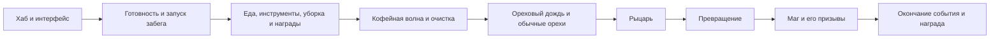
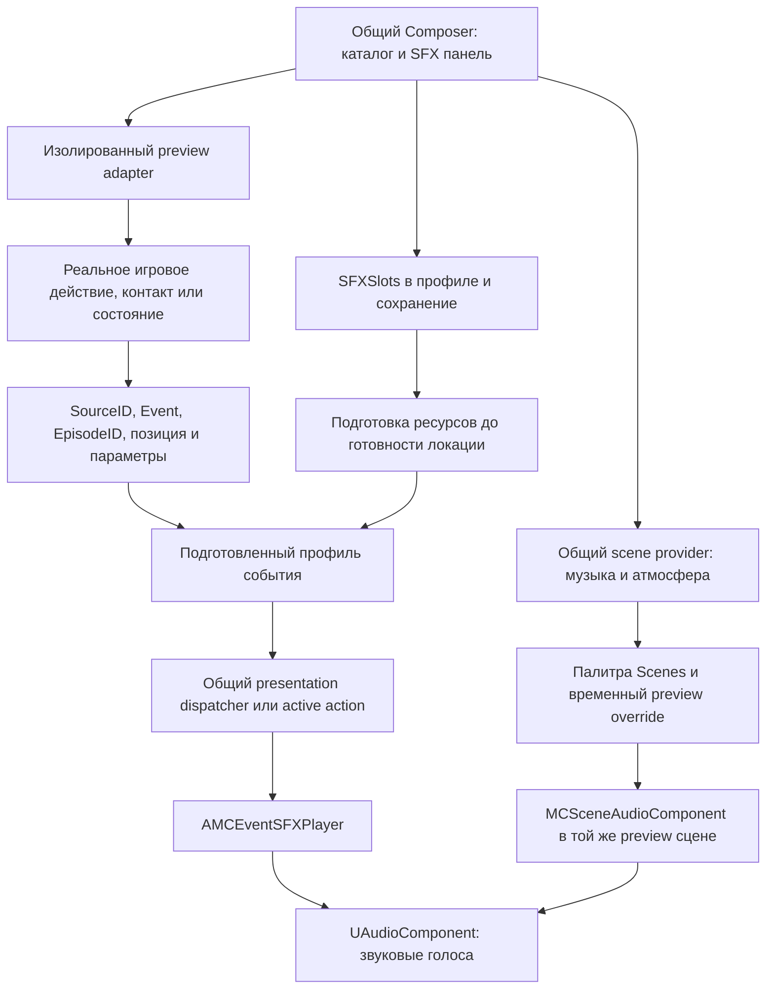

# Карта аудиопревью от хаба до ореховых боссов

Предварительная карта на 14 ноября 2026 года для работы со всем аудио внутри Unreal: SFX, музыка событий, общий и пространственный амбиент, переходы и звуковые акценты. Граница первого этапа: хаб, начало обычного забега, еда и уборка, кофейная волна, ореховый дождь, Рыцарь, превращение в Мага и завершение орехового боя с наградой. Включаются общие действия персонажа и навыки, которые действительно доступны на этом участке.

Основная база уже существует: общий Composer, звуковые слои, профили событий, плеер, подготовка ресурсов, группы, пакеты и сохранение. Основная оставшаяся работа — сопоставить игровые случаи с реальными событиями, подключить недостающие вызовы и проверить результат. Объявленный слот, подключённый вызов, назначенный звук, предпросмотр и слышимость имеют отдельные статусы.

## Целевой процесс работы с аудио

Автор выбирает случай в общем каталоге Composer, нажимает Play, видит настоящую механику и слышит её аудио. Шаг показывает движение и контакт с опорой; каст — подготовку, выпуск, полёт и попадание; смерть — реальную реакцию и завершение; событие — окружение, музыку, амбиент и переходы состояний.

В том же workspace доступны `SFX / Музыка / Атмосфера`: выбор источника, громкость, варианты, повтор, задержка и fades по возможностям случая. Локальные Solo/Mute позволяют слушать слой отдельно или вместе со всем звуком сцены. После изменения автор повторяет тот же сценарий и явно применяет результат к игре. Настройки пространственного затухания, concurrency и техническая диагностика раскрываются по необходимости.

Полноценный contextual preview является частью готовности каждого случая. Карточки без сценария сохраняют статус незавершённого подключения. Сценарий должен быть безопасен для обычного уровня, профиля, валюты и инвентаря: реальные механики запускаются в изолированном контексте с временными данными. Для UI/монет, которым нужен LocalPlayer, требуется подходящий изолированный игровой контекст.

## Общие аудиоданные SFX Composer и VFX Composer

SFX Composer и аудиопанель VFX Composer должны быть двумя представлениями общих данных и общего черновика. Обычная точка входа и каталог остаются у общего Composer; звук можно представить отдельным режимом или панелью. Ниже — обязательный целевой контракт, а не утверждение, что вся синхронизация уже реализована.

- **Один адрес назначения.** Для event SFX это реальный профиль и `SFXSlots[Event]`; для scene music/ambience — настоящая палитра и `Scenes[Scene]`. Нормализованный asset/property/key и GUID слоя определяют общую запись. Один `SourceID` без учёта фактического владельца недостаточен.
- **Один черновик.** Замена звука, Volume/Pitch, время, binding, добавление/удаление/дублирование слоя и authored group policy сразу видны в обеих панелях. Между панелями не требуется экспортировать, копировать или повторно сохранять настройки. Две отдельные локальные копии с последующим взаимным автосохранением не используются.
- **Общие Undo/Redo и применение.** Операция из любой панели становится одной транзакцией общей сессии. Apply/Save сохраняет один канонический источник; другая панель обновляет тот же dirty/saved статус. GUID слоёв, группы, связи с исходными ресурсами и остальные VFX поля сохраняются.
- **Один сеанс preview.** Открытие второй аудиопанели не запускает второй экземпляр музыки или SFX. Play/Pause/Stop/Reset управляют общей сценой, SFX и scene audio. Локальные Solo/Mute прослушивания отделены от сохранённых настроек и пользовательской громкости игры.
- **Независимость дорожек.** Изменение аудио не меняет VFX режимы, Niagara слои, принятые игровые события, урон или тайминг механики. Replace/Disabled для аудио сохраняют существующие ограничения известности оригинального звука.
- **Внешние изменения и сохранение.** Изменения asset editor, загрузка пака и повторное открытие пересобирают обе проекции из общей записи. Ревизия источника проверяется перед Apply; устаревший независимый writer не может молча перезаписать более новые данные. Во время внешнего изменения незавершённый общий черновик сохраняется до согласования с новой ревизией.
- **Область применения видима.** Панель показывает, какое игровое действие/сцена изменяется. Переиспользуемый SoundBase остаётся тем же исходником; редактирование общего ресурса и override конкретного события различаются явно. Ресурсы готовятся для нужной локации, а не глобально для всего каталога.

| Обязательная проверка | Ожидаемое поведение |
| --- | --- |
| Изменить шаг в SFX панели при открытой VFX панели | Те же ресурс, параметры и GUID слоя немедленно отображаются в обеих; preview играет один раз. |
| Изменить audio layer каста в VFX панели | SFX панель показывает тот же черновик; визуальные слои и gameplay параметры сохранены. |
| Добавить/удалить слой, выполнить Undo/Redo из другой панели | Обе панели показывают одинаковый состав, порядок и идентичность слоёв. |
| Изменить музыку/амбиент сцены, сохранить и открыть обе панели заново | Назначение читается из одного канонического scene owner; preview и игра используют его. |
| Остановить/сбросить preview или сменить действие/сцену | Уходят принадлежащие сессии pending loads, SFX, музыка, ambience и retiring voices. |
| Изменить asset извне при незавершённом черновике | Общая сессия обнаруживает новую ревизию и сохраняет черновик; тихой перезаписи нет. |

## Граница игрового маршрута

Схема группирует семейства звуков: еда и награды могут повторяться. Количество порций и доступность предметов задаются сохранённым профилем. Текущий native порядок ключевых событий — `NutEncounter → Jellies → IceEvent → FogBrawl`; ореховый бой приостанавливает обычную поддержку. Основание: [профиль и директор](E:/DEVGAME/MessControl/Source/MessControl/Private/MCSingleDayDirector.cpp:84), [запуск орехового события](E:/DEVGAME/MessControl/Source/MessControl/Private/MCSingleDayDirector.cpp:436).

За границей этого этапа: самостоятельные события желе, полноценного льда, тумана, поздних катаклизмов и legacy финального босса. Их общие звуки движения, еды и интерфейса переиспользуются. Обучение рассматривается как отдельная ветка входа; его полный сценарий не является обязательным повторением обычного забега. Музыка и атмосфера всех сцен первого этапа входят в обязательный аудиорежим. Сочинение новых треков и голосовой чат остаются отдельными задачами.

## Как читать статусы

| Статус | Что подтверждено |
| --- | --- |
| **Контракт** | В коде объявлены стабильные `SourceID` и `Event`. |
| **Вызов** | Найден реальный игровой dispatch в общий presentation/SFX тракт. Это не доказывает заполненный сохранённый слот. |
| **Оригинал** | Указан существующий звуковой ресурс или selector и его отдельное управление. |
| **Сценарий** | В исходнике есть contextual preview provider. Его текущее успешное выполнение и слышимость требуют запуска. |
| **Проверить** | Маршрут, исходный звук, доступность или сохранённое назначение ещё нужно подтвердить. |
| **Предложение** | Дополнительный случай для согласования и будущего подключения. Названия ниже не создают новые runtime ID. |

Ни одна строка этой предварительной карты не получает статус «прослушано и принято». `Unknown` для оригинального аудио означает, что нельзя автоматически разрешать его замену/отключение. Намеренно беззвучные события следует обозначать отдельно.

## Как игровой случай попадает в каталог

Текущая идентичность — пара `FName SourceID + FName Event`. Например, приземление шара Рыцаря имеет `Boss.NutKnight.Roll / JumpImpact`, обычный прыжок Рыцаря — `Boss.NutKnight.Jump / Impact`. Эти имена похожи на иерархические теги, но в данном контракте используются `FName`, а не Actor Tags или `FGameplayTag`.

Механика явно передаёт контекст в принятый момент действия. `NutVFXContext` формирует source/event, а `SpawnPresented` переносит их в runtime cue вместе с положением, параметрами и при необходимости идентичностью эпизода. Плеер читает подготовленные VFX/SFX настройки соответствующего события. Обычная игровая сборка использует runtime presentation; editor Composer редактирует те же источники и запускает настоящую механику через preview adapter. Основание: [формирование контекста](E:/DEVGAME/MessControl/Source/MessControl/Private/MCNutBoss.cpp:84), [принятое приземление шара](E:/DEVGAME/MessControl/Source/MessControl/Private/MCNutBoss.cpp:1704).

Для нового случая нужны общий контракт/регистрация каталога, реальный gameplay hook, сохранённый источник настроек и preview provider. Произвольный `PlaySound`, Niagara spawn или новый Actor Tag не появляются автоматически как завершённый случай Composer. Сам ID не заменяет подключение. Повторения одного и того же события используют один настраиваемый шаблон; отдельный instance/episode не создаёт новый авторский пункт.

## Где находится существующая основа

Scene provider и общая синхронизированная сессия входят в целевое расширение. Остальные узлы таблицы ниже описывают существующую основу; схема не объявляет новый scene writer уже готовым.

| Узел | Текущий источник | Роль |
| --- | --- | --- |
| Общие события | [MCVFXSourceContracts.cpp](E:/DEVGAME/MessControl/Source/MessControl/Private/MCVFXSourceContracts.cpp:26) | Владельцы, события, библиотеки, сведения об оригинальном аудио. |
| Ореховые действия | [MCNutVFXCatalog.cpp](E:/DEVGAME/MessControl/Source/MessControl/Private/MCNutVFXCatalog.cpp:88) | 23 действия и 75 объявленных слотов, имена лабораторных сценариев. |
| Пассивные события | [MCPerkPresentationEvents.cpp](E:/DEVGAME/MessControl/Source/MessControl/Private/MCPerkPresentationEvents.cpp:25) | 27 контрактов пассивок и события реальных условий. |
| Профиль | [MCPerkVFXProfile.h](E:/DEVGAME/MessControl/Source/MessControl/Public/MCPerkVFXProfile.h:56) | Независимые `SFXSlots[Event]` в существующем профиле. |
| Библиотека локации | [MCVFXPresentationLibrary.h](E:/DEVGAME/MessControl/Source/MessControl/Public/MCVFXPresentationLibrary.h:11) | `Profiles[SourceID]`; сохраняет реальные игровые корни ресурсов. |
| Адаптер владельца | [MCWorldPresentationComponent.h](E:/DEVGAME/MessControl/Source/MessControl/Public/MCWorldPresentationComponent.h:13) | Переводит штатные импульсы и длительные состояния в общий тракт. |
| Общий dispatcher | [MCVFXPresentationComponent.cpp](E:/DEVGAME/MessControl/Source/MessControl/Private/MCVFXPresentationComponent.cpp:196) | Подготовка профилей, accepted events, локальные состояния, эпизоды и запуск аудио. |
| Активные навыки | [MCActiveSkillAction.cpp](E:/DEVGAME/MessControl/Source/MessControl/Private/MCActiveSkillAction.cpp:603) | Подготовка и очередь аудио фактических фаз действия, остановка при завершении/отмене. |
| Модель слоя и плеер | [MCEventSFX.h](E:/DEVGAME/MessControl/Source/MessControl/Public/MCEventSFX.h:27), [MCEventSFXPlayer.h](E:/DEVGAME/MessControl/Source/MessControl/Public/MCEventSFXPlayer.h:46) | Несколько источников, время, громкость/тон, 2D/world/socket, повторы, fades, хвосты и lifecycle. |
| Подготовка аудио | [MCEventSFXReadiness.cpp](E:/DEVGAME/MessControl/Source/MessControl/Private/MCEventSFXReadiness.cpp:29) | Удержание ресурсов и начальных данных; подготовка не удостоверяет первый декодированный буфер или слышимость. |
| Редактор звука | [SMCEventSFXPanel.h](E:/DEVGAME/MessControl/Source/MessControlEditor/Private/SMCEventSFXPanel.h:29), [SMCSFXGallery.cpp](E:/DEVGAME/MessControl/Source/MessControlEditor/Private/SMCSFXGallery.cpp) | Панель события, оригиналы/слои, параметры и галерея. |
| Возможности события | [MCVFXActionSession.cpp](E:/DEVGAME/MessControl/Source/MessControlEditor/Private/MCVFXActionSession.cpp:1047) | Отдельно проверяет редактирование, audition, известность оригинала и право замены. |
| Сценическая музыка и атмосфера | [MCSceneAudioComponent.cpp](E:/DEVGAME/MessControl/Source/MessControl/Private/MCSceneAudioComponent.cpp:29) | `UMCSoundPalette.Scenes`, смена сцены, загрузка, повторение и fades. |
| Подбор файлов вне Unreal | [Audio Desk](E:/DEVGAME/MessControl/Tools/AudioDesk/README.md:20) | Существующая библиотека и экспорт предложенных назначений. Приложение не импортирует звук в Unreal и не подтверждает runtime интеграцию. |

Для реализации следует расширять общий каталог и существующие аудиопанели Composer. Audio Desk сохраняет необязательную роль подбора файлов; работа «выбрал случай → вижу и слышу → настроил → применил» полностью доступна в движке. Его исторический каталог не должен становиться второй независимой истиной о подключённых событиях.

## Музыка амбиент и переходы событий

Существующий `UMCSoundPalette.Scenes` хранит по одному Music и Ambience SoundBase с громкостью, повтором и FadeIn/FadeOut. Оба слоя — общие 2D сцены. `MCSceneAudioComponent` умеет продолжать неизменившийся трек, переключать громкость, делать fades/crossfade, отменять устаревшую загрузку и останавливать свои голоса. Это основа будущего общего scene provider, который должен получить тот же draft/Undo/Apply/save/reopen процесс, что event SFX. Источники: [модель сцен](E:/DEVGAME/MessControl/Source/MessControl/Public/MCDataAssets.h:88), [runtime](E:/DEVGAME/MessControl/Source/MessControl/Private/MCSceneAudioComponent.cpp:46).

| Аудиослучай | Что видеть и слышать в целевом preview | Что уже есть и что требуется |
| --- | --- | --- |
| Главное меню и хаб | Соответствующее окружение/интерфейс, фоновая музыка и атмосфера вместе с локальными действиями | Есть ключи `MainMenu`, `Hub` и scene audio вызовы. Нужны общий editor binding и изолированные scene previews. |
| Обычная работа и передышка | Gameplay/Relax, шаги и инструменты поверх выбранного фона | Есть ключи `Gameplay`, `Relax` и выбор реальным controller. Нужен тот же выбор в preview с временной палитрой. |
| Кофейная волна | Видимая волна, поток/локальные брызги и фоновый soundscape, затем уход к обычной работе | SFX поток имеет реальный owner. Самостоятельный music scene key кофе в просмотренном selector не установлен; фон может оставаться общим Gameplay. Отдельная музыка — явное расширение контракта по реальному состоянию. |
| Ореховый дождь | Появление угрозы, падения, музыка и атмосфера столкновения | Существующий `NutEncounter` покрывает активное ореховое событие целиком. Нужен совместный preview scene audio и настоящих падений. |
| Рыцарь, превращение, Маг | Бой и касты с музыкой/амбиентом; переход между фазами без случайного перезапуска общего трека | Отдельных фазовых scene keys сейчас нет: всё выбирает `NutEncounter`. Если автор задаёт разные фоны фаз, добавить реальные phase bindings с сохранённым общим fallback, не выдумывать завершённые ключи. |
| Завершение события и награда | Прекращение боя, музыкальный выход/акцент, награда и следующий фон | Нужен проверяемый переход от настоящего окончания события к награде/следующему контексту. Короткий stinger является отдельным event SFX, фон — scene audio. |
| Пространственная атмосфера | Пруд/объект/источник в сцене, изменение слышимости с расстоянием и камерой | Два существующих scene слоя не являются пространственными зонами. Использовать source-owned spatial SFX provider или явно расширить ambience provider; подтвердить реальные anchors и затухание. |
| Смерть, отмена, Pause/Stop/Reset | Реальная реакция и согласованное поведение звука, музыки, атмосферы и хвостов | Общий preview lifecycle должен охватывать scene voices и pending loads. Нынешний обход pause для event SFX сам по себе этого не удостоверяет. |

Выбор текущего фона: [MCPlayerController.cpp](E:/DEVGAME/MessControl/Source/MessControl/Private/MCPlayerController.cpp:343). Scene ресурсы уже участвуют в сборе manifest: [MCPreloadManifest.cpp](E:/DEVGAME/MessControl/Source/MessControl/Private/MCPreloadManifest.cpp:240); проверить область подготовки при новых сценах и вариантах.

Необходимые additions к editor: запись в реальную `Scenes[Scene]`, общий временный override, preview listener/устройство, независимые SFX/Music/Ambience Solo/Mute, переход между соседними реальными состояниями, общий stop/reset и сохранение из любой аудиопанели. Наличие существующих SFX паков не доказывает сохранение ими scene Music/Ambience. Дополнительные stems, синхронизация по тактам и произвольная многослойная адаптивная музыка — возможные расширения сверх нынешних двух scene слоёв.

## Хаб и интерфейс

| Игровой случай | Существующая идентичность | Реальный владелец | Текущее состояние и следующий шаг |
| --- | --- | --- | --- |
| Главное меню, музыка и атмосфера | `Scenes.MainMenu` | [MCMainMenuPlayerController.cpp](E:/DEVGAME/MessControl/Source/MessControl/Private/MCMainMenuPlayerController.cpp:36) | Есть scene audio вызов. Проверить назначения, переход и остановку. |
| Хаб, музыка и атмосфера | `Scenes.Hub` | [MCPlayerController.cpp](E:/DEVGAME/MessControl/Source/MessControl/Private/MCPlayerController.cpp:344) | Есть scene audio вызов; отдельный Composer source этой сцены не установлен в этом проходе. |
| Наведение, подтверждение, назад, открытие меню | Предложение: общие UI события | [MCGameplayUIWidget.cpp](E:/DEVGAME/MessControl/Source/MessControl/Private/MCGameplayUIWidget.cpp) | Подтвердить общую точку UI звука и существующие Blueprint/style sounds; не добавлять звук отдельно в каждую кнопку. |
| Магазин: открыть/закрыть | Предложение; старый Audio Desk `ShopOpenClose` | [MCPlayerWardrobe.cpp](E:/DEVGAME/MessControl/Source/MessControl/Private/MCPlayerWardrobe.cpp) | Подключить принятые переходы открытия и закрытия; аудио в просмотренном native пути не подтверждено. |
| Покупка: успех/отказ | Предложение; `PurchaseSuccess`, `PurchaseDenied` в старом Audio Desk | [MCHubShopWidget.cpp](E:/DEVGAME/MessControl/Source/MessControl/Private/MCHubShopWidget.cpp:260), [MCHubEconomyComponent.cpp](E:/DEVGAME/MessControl/Source/MessControl/Private/MCHubEconomyComponent.cpp:448) | Разделить UI отказ и подтверждённую транзакцию. Preview использует временный профиль без траты валюты. |
| Гардероб: открыть/закрыть, примерить, применить | Предложение; исторические `Wardrobe*` | [MCHubWardrobeWidget.cpp](E:/DEVGAME/MessControl/Source/MessControl/Private/MCHubWardrobeWidget.cpp:435), [MCPlayerWardrobe.cpp](E:/DEVGAME/MessControl/Source/MessControl/Private/MCPlayerWardrobe.cpp) | Разделить выбор черновика и принятую экипировку. Звуковой adapter не подтверждён. |
| Выбор направления, рейдового перка, готовность, запуск | Предложение для переходов UI/лобби | [MCHubGameMode.cpp](E:/DEVGAME/MessControl/Source/MessControl/Private/MCHubGameMode.cpp:457), [MCHubWidget.cpp](E:/DEVGAME/MessControl/Source/MessControl/Private/MCHubWidget.cpp) | Разделить выбор, готовность, принятый запуск, отказ и travel. Старый `HubSelectDay` не покрывает все нынешние состояния. |
| Зона готовности | `Hub.ReadyZone / Active, Ready` | [MCHubReadyZone.cpp](E:/DEVGAME/MessControl/Source/MessControl/Private/MCHubReadyZone.cpp:117) | Контракт есть; runtime audio dispatch и полный preview не подтверждены. |
| Зона доставки | `Hub.DeliveryZone / Active, Complete` | [MCDeliveryZoneVisualComponent.cpp](E:/DEVGAME/MessControl/Source/MessControl/Private/MCDeliveryZoneVisualComponent.cpp:71) | Контракт есть. Уточнить реального gameplay владельца принятой доставки и подключение аудио. |
| Баскетбол: взять/бросить, контакт, попадание | `Hub.Basketball / Contact, Score`; остальные детали — предложения | [MCHubBasketball.cpp](E:/DEVGAME/MessControl/Source/MessControl/Private/MCHubBasketball.cpp:366) | Попадание имеет реальный gameplay результат и отдельное конфетти. Это не подтверждает вызов объявленного Composer audio source. |
| Удочка: взять/убрать, заброс, леска, касание воды | `Hub.Fishing.Cast / Cast, Line, Ripple`; equip — предложение | [MCFishingRodComponent.cpp](E:/DEVGAME/MessControl/Source/MessControl/Private/MCFishingRodComponent.cpp:141) | Контракт есть; полный runtime SFX маршрут не подтверждён. Нужны реальные cast/contact/start-stop. |
| Поклёвка, подмотка, миниигра, улов | `Hub.Fishing.Cast / Catch`, `EditorOnly.FishingCatch / Catch`; остальные детали — предложения | [MCFishingRodComponent.cpp](E:/DEVGAME/MessControl/Source/MessControl/Private/MCFishingRodComponent.cpp:269), [MCPlayerFishingFeedback.cpp](E:/DEVGAME/MessControl/Source/MessControl/Private/MCPlayerFishingFeedback.cpp) | Отделить мировой улов от UMG награды; существующая анимация награды не доказывает звуковое подключение. |
| Пруд, локальная атмосфера | Предложение `HubPondLocal` из Audio Desk | [MCHubFishingZone.cpp](E:/DEVGAME/MessControl/Source/MessControl/Private/MCHubFishingZone.cpp) | Решить необходимость локального ambience и проверить сохранённые actor sounds. |
| Автомат: приём рыбы, прокрутка, обычный результат | `Hub.Grill / Intake, Spin, Result` | [MCHubGrillStation.cpp](E:/DEVGAME/MessControl/Source/MessControl/Private/MCHubGrillStation.cpp), [MCHubGrillPresentationComponent.cpp](E:/DEVGAME/MessControl/Source/MessControl/Private/MCHubGrillPresentationComponent.cpp) | Контракт и настоящие фазы есть. Эти три audio dispatch не подтверждены; нужен отдельный проход. |
| Автомат: редкий приз | `Hub.Grill / RareWin` | [MCHubGrillPresentationComponent.cpp](E:/DEVGAME/MessControl/Source/MessControl/Private/MCHubGrillPresentationComponent.cpp:969) | Вызов + оригинал: `SW_CaseRareFanfare`, локальный 2D звук получателю. Полного contextual preview нет. |
| Автомат: перезапуск голограммы | `Hub.Grill / Reset` | [MCHubGrillPresentationComponent.cpp](E:/DEVGAME/MessControl/Source/MessControl/Private/MCHubGrillPresentationComponent.cpp:998) | Вызов + оригинал: `SW_CaseHologramReset`, пространственный attached звук. Полного contextual preview нет. |
| Старт смены, поражение, сообщения итога | `UI.ShiftFeedback / Start, Win, Lose` | [MCPrototypeWidget.cpp](E:/DEVGAME/MessControl/Source/MessControl/Private/MCPrototypeWidget.cpp:305), [MCPlayerController.cpp](E:/DEVGAME/MessControl/Source/MessControl/Private/MCPlayerController.cpp:148) | Вызов + оригинальная палитра `DayStart/Win/Lose`. Для этого среза нужны старт и возможное поражение; победа полного забега — отдельный сценарий. |
| Обучение и пользовательские эмоции | `UI.TutorialFeedback / Complete, Prompt`; эмоции — кандидатный случай | [MCTutorialDirector.cpp](E:/DEVGAME/MessControl/Source/MessControl/Private/MCTutorialDirector.cpp), [MCUnifiedEmoteWidget.cpp](E:/DEVGAME/MessControl/Source/MessControl/Private/MCUnifiedEmoteWidget.cpp) | FoamParty Complete имеет оригинал `S_Win`; полный tutorial preview отсутствует. Звуки эмоций и остальных подсказок требуют отдельной разметки. |

Для `Hub.Grill`, `Reward.Chest`, `Reward.PerkPickup`, `Reward.TaskComplete` и `UI.ShiftFeedback` код регистрирует редактируемые hooks без синтетической фабрики сценария: [MCWorldActionPreviewAdapters.cpp](E:/DEVGAME/MessControl/Source/MessControlEditor/Private/MCWorldActionPreviewAdapters.cpp:588). Карточка в каталоге не заменяет настоящий сценарий автомата, покупки или выбора награды.

## Персонаж инструменты еда и кофе

| Игровой случай | Существующий SourceID и события | Владелец | Текущее состояние и следующий шаг |
| --- | --- | --- | --- |
| Шаги и темп движения | `Character.Movement / Step` | [MCToothCharacter.cpp](E:/DEVGAME/MessControl/Source/MessControl/Private/MCToothCharacter.cpp:1722) | Вызов + оригинал palette `Step`. Проверить поверхность, темп и отсутствие двойных шагов. Отдельные left/right/surface события — предложения. |
| Приземление, падение, вставание, тяга | `Character.Movement / Land, Jump, Fall, StandUp, Pull` | [MCToothPhysicsComponent.cpp](E:/DEVGAME/MessControl/Source/MessControl/Private/MCToothPhysicsComponent.cpp:613), character | Вызовы + оригиналы. `Jump` здесь совместимый алиас приземления, а не звук отталкивания. Takeoff, скольжение, гребок и вход/выход воды требуют отдельного решения. |
| Полученный урон | `Character.Hurt / Hit` | [MCCombatFeedbackComponent.cpp](E:/DEVGAME/MessControl/Source/MessControl/Private/MCCombatFeedbackComponent.cpp) | Реальный accepted hit route; исходное аудио проверить. Различить попадание, поглощение и смертельный результат. |
| Гибель, дух, возрождение | `Character.DeathSpirit / Rise, Merge, Release`; `EditorOnly.CharacterDeath` — метаданные | [MCDeathSpiritComponent.cpp](E:/DEVGAME/MessControl/Source/MessControl/Private/MCDeathSpiritComponent.cpp), [MCGameMode.cpp](E:/DEVGAME/MessControl/Source/MessControl/Private/MCGameMode.cpp) | DeathSpirit имеет вызовы; оригинальные звуки проверить. Полного изолированного respawn preview нет. |
| Выбор/смена инструмента | Предложение, исторический `ToolSelect` | [MCInventoryComponent.cpp](E:/DEVGAME/MessControl/Source/MessControl/Private/MCInventoryComponent.cpp) | Зафиксировать принятый переход и момент видимой смены; не считать подтверждённым готовым SFX случаем. |
| Нож и катана | `Tool.Knife`, `Tool.Katana / Swing, Hit, FoodCut` | Character, [MCMeleeCombo.cpp](E:/DEVGAME/MessControl/Source/MessControl/Private/MCMeleeCombo.cpp), [MCWeaponTrailComponent.cpp](E:/DEVGAME/MessControl/Source/MessControl/Private/MCWeaponTrailComponent.cpp) | Swing/Hit имеют вызовы и palette оригиналы. FoodCut имеет вызов, original audio проверить. Есть real tool adapters. Учесть разные цели и charged серию катаны. |
| Кирка | `Tool.Pickaxe / Swing, Hit` | Character, inventory, melee | Вызов + оригиналы `PickaxeSwing/PickaxeHit`. Материал цели и варианты impact проверяются отдельно от взмаха. |
| Щётка | `Tool.Brush / Contact` | [MCBrushContactComponent.cpp](E:/DEVGAME/MessControl/Source/MessControl/Private/MCBrushContactComponent.cpp) | Вызов + palette `Brush`; реальный crown-contact сценарий есть. Проверить язык, край, отсутствие контакта и прекращение звука. |
| Спрей и водяной пистолет | `Tool.Spray / Start, WaterCare, Contact, End`; `Tool.Watergun / Shot, Impact` | Inventory, [MCReactionVFX.cpp](E:/DEVGAME/MessControl/Source/MessControl/Private/MCReactionVFX.cpp) | Spray Contact сопоставлен palette Brush. Остальные аудио-фазы проверить; spray preview есть. Доступность Watergun до орехов уточняется по игровым данным. |
| Очистка пятен | `EditorOnly.CleanStain / Contact, Complete, Surface` | [MCMouthSurface.cpp](E:/DEVGAME/MessControl/Source/MessControl/Private/MCMouthSurface.cpp), cleaning/result owners | Контракт и surface preview есть; original audio проверить. Звук контакта и завершения очистки имеют разные условия. |
| Очистка/ремонт большого зуба | `EditorOnly.CleanArenaTooth`, `EditorOnly.RepairArenaTooth / Contact, Complete` | [MCToothCareFeedbackComponent.cpp](E:/DEVGAME/MessControl/Source/MessControl/Private/MCToothCareFeedbackComponent.cpp) | Принятые care вызовы и реальные adapters есть. Проверить оригиналы и не дублировать общий звук щётки. |
| Фортепианный отклик | `World.ArenaTooth.Piano / Hit` | [MCArenaTooth.cpp](E:/DEVGAME/MessControl/Source/MessControl/Private/MCArenaTooth.cpp) | Оригиналы C4–C7 и реальный piano adapter. Октава/сила остаются входом механики. |
| Появление еды, контакт с поверхностью, захват, бросок, рассыпание | Предварительные дополнительные случаи | [MCFoodActor.cpp](E:/DEVGAME/MessControl/Source/MessControl/Private/MCFoodActor.cpp), [MCFoodCollectionComponent.cpp](E:/DEVGAME/MessControl/Source/MessControl/Private/MCFoodCollectionComponent.cpp) | Проверить реальные владельцы и старое embedded audio. Не вводить по одному звуку на каждый физический tick/осколок. |
| Разлом еды и пыль | `Food.Break / BreakArt, BreakDust` | Food actor, ReactionVFX | Реальные вызовы и food-damage adapter есть; оригинальное аудио проверить. |
| Съедено или выброшено | `Food.AutoMouth / Consume, Discard` | Food intake, GameState | Вызовы и real adapter есть. Разделить свежую еду и мусор, сохранить реальные endpoints. |
| Брошенный орех попал в босса | `Food.NutThrow / BossImpact` | [MCFoodNutThrow.cpp](E:/DEVGAME/MessControl/Source/MessControl/Private/MCFoodNutThrow.cpp), GameState | Реальный accepted impact; проверить оригинал и сценарии shield/HP/промах/повторное касание. |
| Испорченная еда и перец | `Food.Spoiled / Loop`; `Food.Spicy / DetonateArt` | [MCFoodEnvironment.cpp](E:/DEVGAME/MessControl/Source/MessControl/Private/MCFoodEnvironment.cpp), detonation/ReactionVFX | Вызовы и food adapters есть. Включать по доступности еды в этом срезе; проверить остановку loop и остаточные угрозы. |
| Глотка и всасывание | `World.Throat.Suction / Start, Loop, Intake, End` | [MCThroatVortex.cpp](E:/DEVGAME/MessControl/Source/MessControl/Private/MCThroatVortex.cpp) | Start/Loop имеют оригиналы `S_Whoosh`, suction wind и fallback `S_Pull`. Intake/End audio проверить; реальные состояния не заменять произвольным таймером. |
| Кофейная волна | Реально используемый `World.CoffeeRiver / Flow, Accents`; `Impact` объявлен | [MCCoffeeFlood.cpp](E:/DEVGAME/MessControl/Source/MessControl/Private/MCCoffeeFlood.cpp:1027), [MCCoffeeRiverAccents.cpp](E:/DEVGAME/MessControl/Source/MessControl/Private/MCCoffeeRiverAccents.cpp:82) | Есть подготовка/обновление CoffeeRiver и реальный adapter. Проверить начало, интенсивность, сток и stop. Контракт `World.CoffeeFlood / Pour, Flow, Drain` отдельно не доказывает runtime маршрут. |
| Завершённая задача и монеты | `Reward.TaskComplete / Complete`; `Reward.TaskCoins / Reward` | [MCTaskActor.cpp](E:/DEVGAME/MessControl/Source/MessControl/Private/MCTaskActor.cpp), [MCTaskCoinPresentationComponent.cpp](E:/DEVGAME/MessControl/Source/MessControl/Private/MCTaskCoinPresentationComponent.cpp:198) | Оригиналы palette Complete / `S_TaskCoins`, native gates есть. Уточнить реальные задачи раннего маршрута. Coin preview требует LocalPlayer/viewport; обычной песочницы недостаточно. |
| Сундук, бустер этапа, подбор перка | `Reward.Chest / Arrival, Open, Claim`; `Reward.StageBooster / Spit, Arrival, Open, Claim`; `Reward.PerkPickup / Arrival, Claim` | [MCRewardChest.cpp](E:/DEVGAME/MessControl/Source/MessControl/Private/MCRewardChest.cpp:442), [MCSingleDayDirectorRewards.cpp](E:/DEVGAME/MessControl/Source/MessControl/Private/MCSingleDayDirectorRewards.cpp), [MCPerkPickup.cpp](E:/DEVGAME/MessControl/Source/MessControl/Private/MCPerkPickup.cpp) | Настоящие вызовы есть; original audio проверить. Spit/полёт/посадка имеют частичный сценарий; полный open → выбор → claim не закрыт. |
| Огонь, зевок, выброс, язвы, зубной камень, зубочистка | `World.FirePatch / Loop, Contact, Steam`; `World.Yawn / Wind`; `World.Vomit / Burst`; `World.DamageUlcer / Wave`; `World.Calculus / Chip, Break`; `World.Toothpick / Impact` | Соответствующие native hazard/care owners | Условный список по фактической доступности до орехов. Для каждого подтвердить audio route, источник и нужность отдельного звука. Полные поздние события этим не включаются. |

Основные tool/care adapters: [MCWorldActionPreviewAdapters.cpp](E:/DEVGAME/MessControl/Source/MessControlEditor/Private/MCWorldActionPreviewAdapters.cpp:498). Food/reward adapters и ограничение монет: [MCFoodRewardPreviewAdapters.cpp](E:/DEVGAME/MessControl/Source/MessControlEditor/Private/MCFoodRewardPreviewAdapters.cpp:133).

## Активные навыки и пассивки

Авторский список содержит кандидатов `Active_Sponge`, `Active_Hook`, `Consumable_Grenade`, `Consumable_Air`, `Consumable_Rocket`. `Consumable_Driver` выключен. Основание: [active_skill_specs.json](E:/DEVGAME/MessControl/Tools/Unreal/UI/active_skill_specs.json). Наличие в авторском списке не доказывает доступность каждой покупки/выдачи до орехового события; эту границу нужно подтвердить сохранёнными игровыми данными.

Общий active audio runtime уже умеет подготовку, очередь и остановку. Для каждого навыка нужны его фактические фазы, контакты и прекращение при отмене/гибели. Имена `Start/Loop/Impact/End/Warning` не следует навязывать каждому навыку целиком: список берётся из конкретного действия.

| Группа пассивок | Существующие ID и дополнительные события | Что проверять |
| --- | --- | --- |
| Базовые параметры и обычные действия | `B1_HeavyHit/Hit`, `B1_LightFoot`, `B1_DeepBreath`, `B1_BigPortion/Pickup`, `B1_GreedyHands/Pickup`, `B1_ConfidentThrow/Throw` | Какие случаи получают самостоятельный звук, а какие намеренно используют обычное действие. Числовому бонусу не обязателен постоянный звук. |
| Переноска и инструменты | `B1_FreshDelivery/CarryStart,CarryEnd`, `B1_WideBristles/Contact`, `B1_UnderPressure/SprayStart,SprayEnd` | Настоящие carry/contact edges; прекращение при отпускании, смене инструмента и смерти. |
| Лечение, скорость и защита | `B2_ReturnTrip/Proc,End`, `B2_CleanBreath/Proc`, `B2_CleanAcceleration/Proc,End`, `B2_RefreshingWork/Proc`, `B2_ThickEnamel/Proc`, `B2_Shield/Proc`, `B2_SecondWind/Proc`, `B2_StartFromDash/Proc`, `B2_HoudiniDash/Vanish,Return` | Реальное принятое условие, начало/обновление/конец, однократность. Не повторять gameplay RNG или лечение в аудио. |
| Удары и цепные реакции | `B2_NeatFreak/Link`, `B2_LastStroke/FinishContact`, `B2_MightyTooth/Cleave`, `B2_ThunderGod/Link`, `B2_EchoSwing/Windup,Echo`, `B2_Billiards/Launch,Impact` | Исходный perk ID, настоящие endpoints, количество контактов и ограничения наложения. |
| Покрытия и спрей | `B2_Softener/Coat,End`, `B2_Antiseptic/SprayStart,SprayEnd,Clean`, `B2_LastingFormula/Coat,Refresh,End,Damage` | Refresh против нового эпизода, завершение/исчезновение цели, общий и отдельный tool loop. |

Все 27 контрактов также объявляют `Equipped` и `State`. Это не 27 готовых звуков: общий dispatcher существует, часть accepted hooks видна в коде, но оригиналы и сохранённые SFX назначения каждой пассивки требуют проверки. Источники: [контракты](E:/DEVGAME/MessControl/Source/MessControl/Private/MCPerkPresentationEvents.cpp:25), [результаты уборки](E:/DEVGAME/MessControl/Source/MessControl/Private/MCResultPassives.cpp:118).

## Ореховый дождь Рыцарь и Маг

В текущем каталоге **23 действия и 75 event-слотов**. Это точный счёт объявлений этого каталога, а не количество необходимых аудиофайлов или готовых SFX. В таблице приведены существующие ID; для компактности `Knight` означает `Boss.NutKnight`, `Mage` — `Boss.NutMage`.

У всех 23 действий указан лабораторный сценарий. Shield/Fireball имеют отдельные adapters, остальные используют общий native nut adapter: [каталог](E:/DEVGAME/MessControl/Source/MessControl/Private/MCNutVFXCatalog.cpp:88), [регистрация сценариев](E:/DEVGAME/MessControl/Source/MessControlEditor/Private/MCNutActionVFXPreviewAdapters.cpp:524). Здесь подтверждена реализация сценариев в исходнике, не их текущее прослушивание.

| SourceID | Объявленные Event | Основной owner | Сценарий |
| --- | --- | --- | --- |
| `Knight.Shield` | `Hit, Break, Durability` | `AMCNutBoss`, `AMCNutCombatEffect` | `TankShieldHit`, отдельный adapter |
| `Knight.Melee` | `Tell, Slash, Slam` | Boss → combat cue | `TankMelee` |
| `Knight.Charge` | `Tell, Move` | Boss → combat cue | `TankCharge` |
| `Knight.Roll` | `Transform, TransformBurst, Tell, Move, JumpTell, JumpImpact` | Boss, ground/tongue presentation | `TankRoll` |
| `Knight.Jump` | `Tell, Impact` | Boss, настоящий контакт | `TankJump` |
| `Knight.CounterShove` | `Tell, Impact` | Boss, accepted player contact | `TankCounterShove` |
| `Knight.Chain` | `Tell, Spin, Release, Flight, CatchPlayer, CatchNut, Reel, Impact, End, Fracture` | `MCNutBossChain`, `MCNutBossChainPresentation` | `TankChain`: Player / Nut / Miss |
| `Knight.Entrance` | `Tell, Impact` | Падение/посадка босса | `TankEntrance` |
| `Knight.Death` | `Burst, BodyBurst` | Поражение/разрушение босса | `TankDeath` |
| `Knight.Transform` | `HeadSplit, HeadDust` | Рыцарь → настоящий Маг | `TankHeadSplit` |
| `Mage.Fireball` | `Charge, Release, Flight, Impact` | Boss, projectile/combat cue | `MageFireball`, отдельный adapter |
| `Mage.Melee` | `Tell, Slash` | Boss → combat cue | `MageMelee` |
| `Mage.Summon` | `Focus, ReleaseBurst, GroundTell, Release` | Boss → encounter → kamikazes | `MageSummon` |
| `Mage.NutRain` | `Focus, ReleaseBurst, Storm, DropTrail, Approach, Impact` | Boss, rain event, landing shadow | `MageNutRain` |
| `Mage.GravityWaves` | `LiftLeft, DropLeft, LiftRight, DropRight, NutLift, Approach, Impact` | Boss, rain event, landing shadow | `MageGravityWaves` |
| `Mage.Flash` | `Departure, Arrival` | Реальное уклонение босса | `MageFlash` |
| `Mage.NutSphere` | `ChargeLeft, ChargeRight, Merge, Shot` | Boss, encounter, физический орех | `MageNutSphere` |
| `Mage.Teleport` | `Tell, Transfer, ArrivalBurst` | Boss → combat cue | `MageTeleport` |
| `Mage.Entrance` | `Tell, Impact` | Посадка босса | `MageEntrance` |
| `Mage.Death` | `Burst, BodyBurst` | Поражение/разрушение босса | `MageDeath` |
| `Enemy.NutKamikaze.Fuse` | `Fuse, Danger` | `AMCNutKamikaze::PresentFuse` | `KamikazeFuse` |
| `Enemy.NutKamikaze.Blast` | `Impact` | `AMCNutKamikaze::Detonate` | `KamikazeBlast` |
| `Event.NutRain.Entry` | `Approach, Impact` | Encounter и настоящий floor contact | `RainEntry` |

Отдельные общие реакции: `Enemy.Nut.Hurt/Hit`, `Boss.NutKnight.Hurt/Hit`, `Boss.NutMage.Hurt/Hit`, `EditorOnly.NutEnemyDeath/Death,DeathDust`. Их не следует терять при проходе только по 23 строкам attack-каталога. Владельцы: [MCNutEnemy.cpp](E:/DEVGAME/MessControl/Source/MessControl/Private/MCNutEnemy.cpp:43), [MCCombatFeedbackComponent.cpp](E:/DEVGAME/MessControl/Source/MessControl/Private/MCCombatFeedbackComponent.cpp), source contracts.

Отдельная проверка детализации ударов: сейчас первые два контакта melee combo используют один `Melee/Slash`, третий — `Melee/Slam`. Первый и второй удар не имеют независимых authoring slots. Если автор должен настраивать их раздельно, требуется явное различие события или typed variant/contact input. `EpisodeID` этого различия не создаёт. При этом `Slash` означает исполнение атаки; подтверждённое получение урона конкретной целью имеет отдельную hurt/reaction ветку. Основание: [исполнение melee контактов](E:/DEVGAME/MessControl/Source/MessControl/Private/MCNutBoss.cpp:2163).

Оригинальный звук цепи уже сопоставлен: `Release → S_Whoosh`, `CatchPlayer → S_Hit`, `CatchNut/Impact → Sfx_RockBorn_Cue`. Остальные события цепи контракт явно считает не имеющими original sound. Узкое `ConfirmedAbsent` также есть для `Knight.Melee/Tell` и `Mage.Melee/Tell,Slash`. Для остальных боссовых событий исходное аудио остаётся **проверить**, включая звуки внутри Blueprint, анимационных notify и Niagara. Основание: [default sounds](E:/DEVGAME/MessControl/Source/MessControl/Private/MCNutVFXCatalog.cpp:37), [точные правила известности](E:/DEVGAME/MessControl/Source/MessControl/Private/MCVFXSourceContracts.cpp:207).

Главные файлы навигации: [MCNutBoss.cpp](E:/DEVGAME/MessControl/Source/MessControl/Private/MCNutBoss.cpp), [MCNutCombatEffect.cpp](E:/DEVGAME/MessControl/Source/MessControl/Private/MCNutCombatEffect.cpp), [MCNutBossChain.cpp](E:/DEVGAME/MessControl/Source/MessControl/Private/MCNutBossChain.cpp), [MCNutBossChainPresentation.cpp](E:/DEVGAME/MessControl/Source/MessControl/Private/MCNutBossChainPresentation.cpp), [MCNutRainEvent.cpp](E:/DEVGAME/MessControl/Source/MessControl/Private/MCNutRainEvent.cpp), [MCNutLandingShadow.cpp](E:/DEVGAME/MessControl/Source/MessControl/Private/MCNutLandingShadow.cpp), [MCNutKamikaze.cpp](E:/DEVGAME/MessControl/Source/MessControl/Private/MCNutKamikaze.cpp).

## Порядок подключения

1. **Закрепить список и общий контракт редактирования.** Уточнить доступные до орехов предметы/перки, сохранённые назначения, embedded audio и намеренно тихие случаи. Сопоставить каждый SFX/scene binding единственному владельцу и общей сессии обеих панелей.
2. **Проверить короткий сквозной маршрут.** Step, Knife Hit, Grill RareWin и Chain Release/Catch/Impact дают примеры палитры, контакта, 2D награды и движущегося пространственного действия. Добавить один полный scene переход Gameplay → NutEncounter → следующий фон и синхронное редактирование из обеих панелей.
3. **Закрыть общий ранний геймплей.** Персонаж, инструменты, еда, кофе, глотка, награды; затем хаб/UI и доступные навыки/пассивки. Существующие сценарии использовать повторно, отсутствующие оформлять отдельно.
4. **Пройти боссов по семействам.** Shield/Melee/Charge/Jump → Roll/Chain/transform/death → Fireball/Flash/Teleport/NutSphere → Summon/Kamikaze → Rain/GravityWaves. Последними проверить полный бой и награду.
5. **Завершить сохранение и локальную проверку.** Пройти общие Undo/Redo, внешний asset update, save/reopen в обеих панелях, готовность ресурсов, реальное слышимое воспроизведение SFX вместе с Music/Ambience и interruption/reset. Проверки сети и package/cook планируются отдельно по запросу.

Для каждой строки будущий чек-лист: правильный `SourceID/Event` или scene binding → реальный trigger/состояние → исходный звук или явное решение о тишине → общий черновик → назначение слоя → положение/параметры → начало/обновление/конец → синхронизация обеих панелей → сохранение → ресурсы локации → реальный визуальный preview вместе со слышимым результатом. Циклы дождя, фитиля, кофейного потока и движущейся цепи завершаются по их действительному состоянию/эпизоду. Законченный аудиослучай должен давать возможность видеть, слышать, редактировать и повторять его прямо в Composer.

## Границы предварительной карты

Codebase MCP использован для поиска символов, связей и проверки покрытия проекта `E-DEVGAME-MessControl`. Проверенные пути индекса отмечены `metadata_changed`, а source contracts дополнительно имеют частичный разбор; связи и номера строк сверялись с текущим исходником. Граф служит навигацией, полноту UE reflection и dynamically registered событий он не удостоверяет.

Карта описывает текущий рабочий исходник, включая существующие незакоммиченные изменения других задач. Свежий полный saved-package/BP/notify/Niagara audio audit и фактическое прослушивание не проводились. Поэтому здесь нет процента готовности всей озвучки и доказательств отсутствия звука по пустому поиску. Audio Desk каталог датирован 24 октября 2026 года и используется как исторический список кандидатов; его `wired/needs_hook` не заменяют актуальную проверку.

В рамках подготовки карты добавлен только этот документ. Игровой код, пакеты и назначения звуков не изменялись; сборки, PIE, сетевые тесты и cook/package не запускались.
